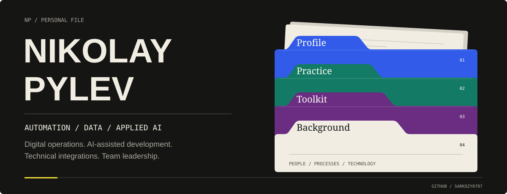

I work across digital operations, analytics and AI-assisted development. My background combines team leadership, client-facing work and technical integrations.

## 01 / Practice

- Turn working requirements into interface flows, data rules and small, testable changes.
- Use AI for implementation, prototyping and debugging; verify the output against data and real workflows.
- Work with APIs, S2S postbacks, Web SDKs, tracking pixels and conversion attribution.
- Connect operational context with technical implementation and feedback from the people using it.

## 02 / Toolkit

Technologies used in my work, grouped by area rather than proficiency rating.

| Area | Tools |
| :--- | :--- |
| Languages | TypeScript · JavaScript · SQL |
| Interfaces | React · Next.js · Tailwind CSS |
| Runtime & tooling | Node.js · Vite · Electron |
| Data | PostgreSQL · SQLite · Drizzle ORM · Supabase |
| Delivery | Docker · Cloudflare · GitHub Actions |
| Validation | Node.js test runner · ESLint · TypeScript checks |

<strong>03 / Technical context</strong>

 

API integrations, client-server interaction, HTTP/HTTPS, DNS and data transfer between systems.

Foundational knowledge of CI/CD, Docker, Kubernetes, Nginx, Kafka, OSI and TCP/IP. I distinguish using a tool from operating it at an expert level.

<strong>04 / Background</strong>

 

Account Team Lead background: coordinating people, working with enterprise clients, managing expectations, and connecting commercial, operational and technical requirements.

I am interested in automation, analytics and practical applications of AI, without limiting my work to one job title.

Outside work: video editing and post-production in DaVinci Resolve.

---

**Contact:** [Telegram](https://t.me/Sarkozy0) · [LinkedIn](https://www.linkedin.com/in/nikolay-pylev-849ba9425/)
